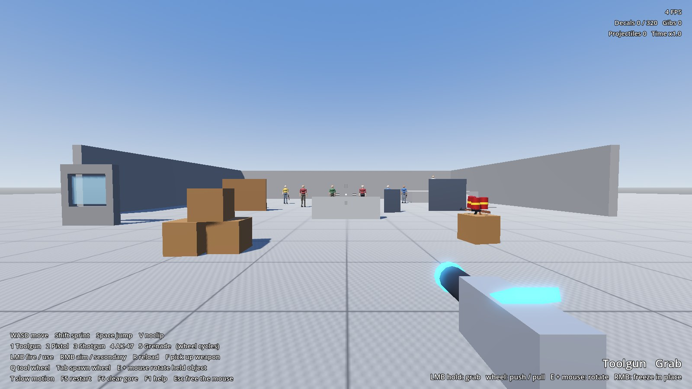
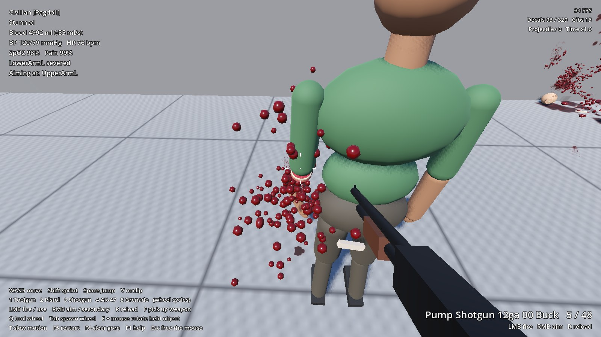
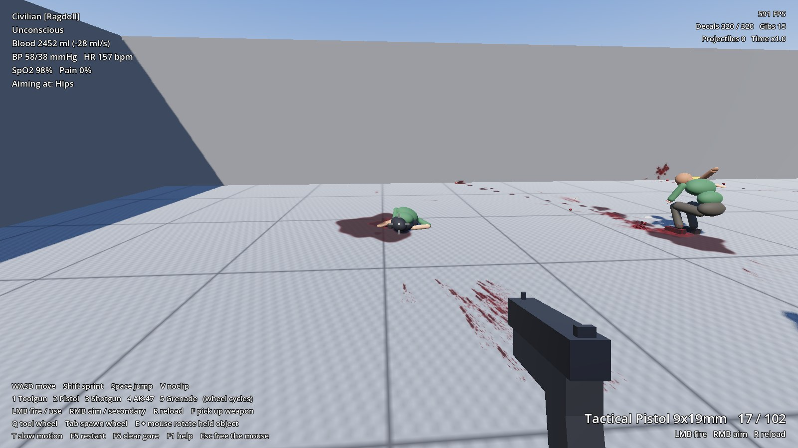
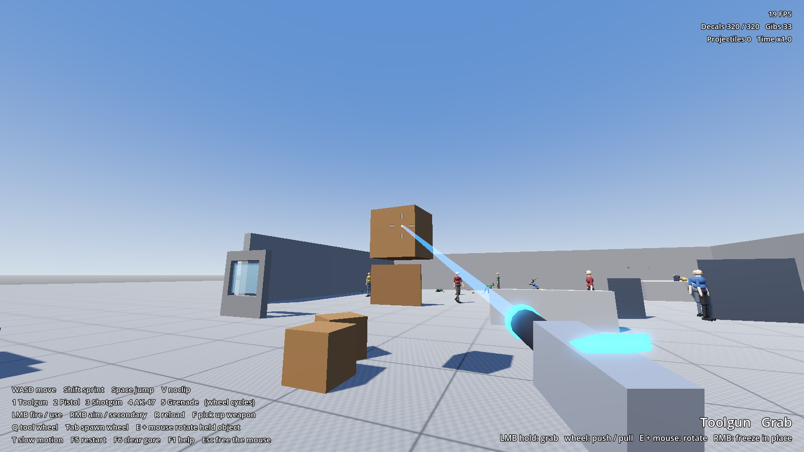
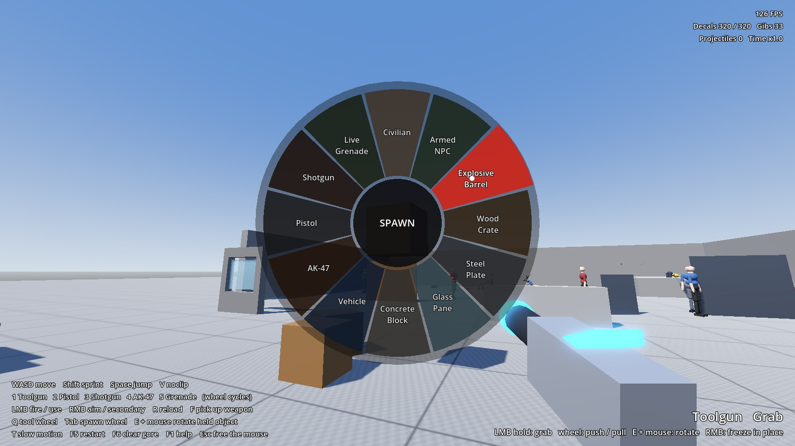

# SandboxGore

A first-person gore and physics sandbox prototype for Godot 4.7, in the spirit of GoreBox and
People Playground: anatomically layered damage, organs and blood pressure, active ragdolls
that stumble, crawl and bleed out, penetrating ballistics, dismemberment and a toolgun.

It is a prototype. Everything is built in code from primitives and synthesised sound, so the
project carries no art assets, and the simulation is tuned for play rather than validated. See
[Known approximations](docs/ARCHITECTURE.md#known-approximations).



## Run it

1. Install Godot 4.7.2, standard build, from the
   [download archive](https://godotengine.org/download/archive/).
2. Open `project.godot` in the editor and press F5.

From a shell:

```sh
godot --headless --path . --import     # once per clone
godot --path .
```

The project uses Jolt Physics and the Forward+ renderer, so it needs a GPU with Vulkan or
Direct3D 12 support.

## Controls

| Input | Action |
| --- | --- |
| W A S D, Shift, Space | Move, sprint, jump |
| Mouse, LMB, RMB | Look, fire or use, aim or secondary action |
| 1 to 5, mouse wheel | Toolgun, pistol, shotgun, AK-47, grenade |
| R, F | Reload, pick up a weapon |
| Q, Tab | Tool wheel, spawn wheel: hold, move the mouse, release |
| E + mouse | Rotate the object the toolgun is holding |
| T, V | Slow motion, noclip |
| F5, F6, F1, Esc | Restart, clear gore, toggle help, free the mouse |

Grenade: hold LMB to pull the pin and release to throw. RMB while the pin is out lets the
spoon go, which cooks the fuse in the hand.

Aim at a body to read its vitals and injuries in the top left corner.

## What is in it

- **Anatomy and damage.** 14 body parts with layered hitboxes (skin, bone shell, muscle, bone
  core) and 11 organ and artery volumes. A bullet loses energy layer by layer and leaves with
  what is left.
- **Vitals.** Blood volume, pressure, heart rate, oxygen saturation, pain and consciousness. A
  heart shot collapses the circulation in seconds; a femoral bleed takes about a minute.
- **Active ragdolls.** NPCs stand and walk on joint motors and balance, stumble when hit,
  cower, crawl on a ruined leg and go limp when they lose consciousness.
- **Gore.** Wound marks, pressure-driven arterial spurts, pools, dismemberment with stump
  caps, and giblets, all from fixed-size pools.
- **Weapons.** Pistol, pump shotgun, AK-47 and an M67 grenade with pin and spoon. Ballistics
  are hybrid: hitscan at short range, simulated drop and drag beyond it. Wood, steel,
  concrete, glass and flesh each stop a round differently.
- **Toolgun.** Grab, freeze, weld, pin, spawn and remove, chosen from radial wheels.

| | |
| --- | --- |
|  |  |
| Point-blank buckshot takes a forearm off. The stump is capped and bleeds, and the inspector lists the injury. | A femoral bleed after 47 s: half the blood gone, pressure collapsing, unconscious. |
|  |  |
| The toolgun in Grab mode, holding a crate. | The spawn wheel. |

The screenshots come from `tests/ScreenshotTour.gd` on a software renderer, so the FPS
counter in them means nothing.

## Tests

```sh
godot --headless --fixed-fps 60 --path . res://tests/TestRunner.tscn
```

22 scenarios with 117 checks run against the real systems in a few seconds. The exit status is
0 only when all of them pass. Details are in [docs/ARCHITECTURE.md](docs/ARCHITECTURE.md#tests).

## Windows build

```sh
tools/export_windows.sh
```

This writes `build/windows/SandboxGore.exe` and `SandboxGore.pck` for x86_64. Jolt is part of
the engine, so there are no DLLs to ship. Templates, the preset, checks, troubleshooting and
performance budgets are covered in [docs/WINDOWS_EXPORT.md](docs/WINDOWS_EXPORT.md).

## Documentation

- [docs/ARCHITECTURE.md](docs/ARCHITECTURE.md): systems, scene tree, how a hit travels, Jolt
  specifics, known approximations.
- [docs/WINDOWS_EXPORT.md](docs/WINDOWS_EXPORT.md): export guide and performance guidance.
